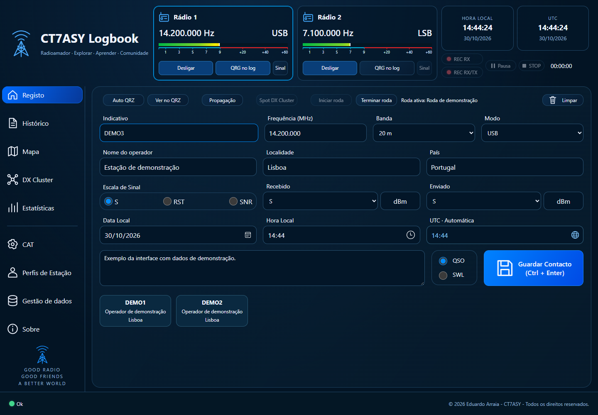

# Logbook

Livro de registo de contactos de radioamador, com ligação CAT, gravação de áudio e gestão de rodas.

**Desenvolvido por Eduardo Arraia — CT7ASY.**

[**Descarregar a versão mais recente para Windows**](https://github.com/CT7ASY/CT7ASY-Logbook/releases/latest)

*Imagem ilustrativa com contactos e leituras de rádio de demonstração.*

## Funcionalidades

- Registo de contactos QSO e de estações recebidas em SWL, com frequência, modo, sinais e horas local e UTC.
- Vários perfis de estação, com indicativo e locator.
- Dois canais CAT, com frequência, modo e leitura de sinal nos equipamentos compatíveis.
- Consulta QRZ e preenchimento de dados em falta no Histórico.
- Gravação de áudio por entrada Windows, DAX ou rede, conforme o rádio e a configuração. Uma gravação pode ficar associada a vários contactos e ser ouvida no Histórico.
- Rodas com participantes, indicação de saída e regresso, ordenação por arrasto e associação dos contactos.
- Histórico com pesquisa, filtros, seleção múltipla e importação/exportação ADIF.
- DX Cluster com filtros de spots e envio após confirmação.
- Mapa com distância, azimute e caminho curto/longo; previsão de propagação HF através de VOACAP.
- Backup SQLite e backup completo em ZIP com áudio associado.
- Interface, manual e guia rápido em português, inglês e espanhol.
- Verificação de atualizações ao abrir o programa e em **Sobre → Procurar atualizações**.

## Instalar

1. Abre a [página de download](https://github.com/CT7ASY/CT7ASY-Logbook/releases/latest) e descarrega o instalador **Instalar.Logbook.V…CT7ASY.exe**, na secção **Assets**.
2. Executa o instalador. Nas novas instalações, a pasta proposta é **`C:\CT7ASY\Logbook`**. Ao atualizar, conserva a pasta da instalação existente para continuar a usar os teus dados.
3. Abre o atalho **Logbook** no Ambiente de Trabalho.
4. Em **Perfis de Estação**, cria o perfil com o teu indicativo e locator e seleciona-o.
5. Configura CAT, áudio, QRZ e DX Cluster se pretenderes usar essas funções. A ligação a um rádio é opcional: também podes registar contactos manualmente.

O instalador inclui os componentes necessários ao programa; não precisas de instalar Python separadamente.

## Requisitos

- Windows de 64 bits.
- Microsoft Edge ou Google Chrome instalado.
- Internet para QRZ, DX Cluster, mapa online, previsão de propagação e procura de atualizações. O registo local continua disponível sem Internet.
- Rádio e interface compatíveis para CAT ou áudio. SmartSDR/DAX são necessários quando escolhidos como fonte.

O suporte de sinal e áudio depende do equipamento e do protocolo. Uma entrada de áudio Windows grava o que lhe é entregue e não distingue automaticamente receção de transmissão. A propagação apresentada é uma previsão estatística mensal, não uma medição em tempo real.

## Manual e ajuda

Em **Sobre**, abre **Manual do utilizador**, **Guia rápido**, **Funcionalidades** e **Avisos de terceiros**. O manual e o guia estão incluídos na instalação e podem ser consultados offline.

As alterações de cada versão estão descritas em [Releases](https://github.com/CT7ASY/CT7ASY-Logbook/releases).

## Atualizações e cópias de segurança

Antes de atualizar, termina a gravação, guarda o contacto em edição, faz uma cópia de segurança e fecha o Logbook. A opção **Descarregar e instalar** verifica a integridade do instalador antes de abrir o assistente.

O **backup SQLite não inclui os ficheiros de áudio**. O **backup completo + áudio** inclui a base de dados e as cópias associadas aos contactos. As gravações originais guardadas noutras pastas devem ser copiadas separadamente. Os logins protegidos pelo Windows não acompanham o backup da base; ao mudar de computador, volta a iniciar sessão.

## Tecnologias

- **Python** no serviço local e nas integrações com os rádios.
- **HTML, CSS e JavaScript** na interface.
- **SQLite** para guardar contactos e configurações.
- **PyInstaller e Inno Setup** para o executável e o instalador Windows.

## Autoria e distribuição

Desenvolvimento: **Eduardo Arraia — CT7ASY**.

Com a colaboração de **Pedro Martins — CT1COU** e **Carlos Alberto — CT7ADX**.

Software de distribuição gratuita. © 2026 Eduardo Arraia — CT7ASY. Todos os direitos reservados. As licenças dos componentes de terceiros acompanham a instalação.

Este repositório destina-se à distribuição do instalador e da documentação. O código-fonte não está incluído nesta publicação.
